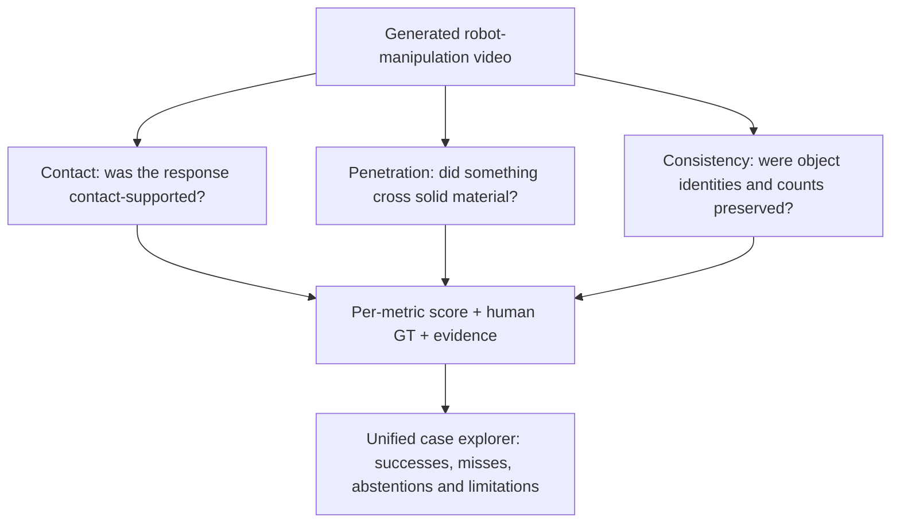
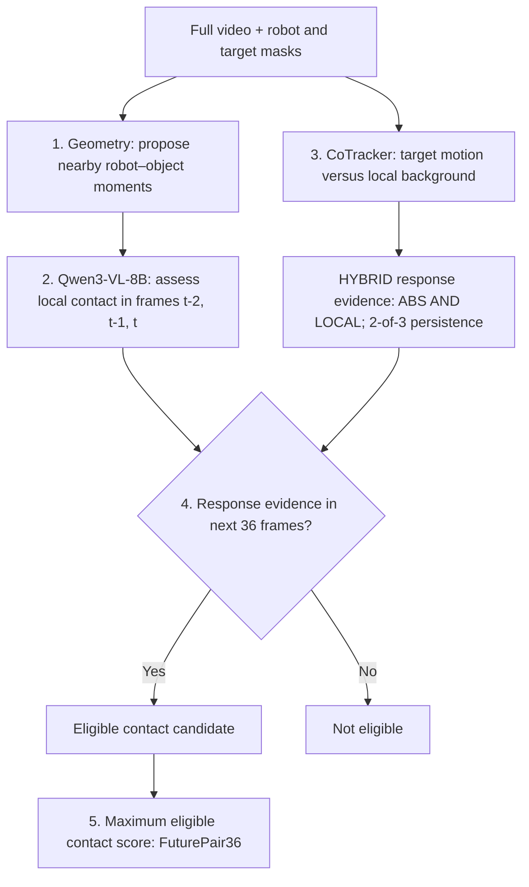
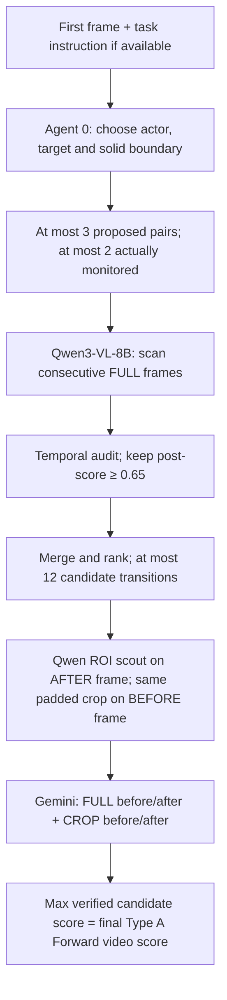
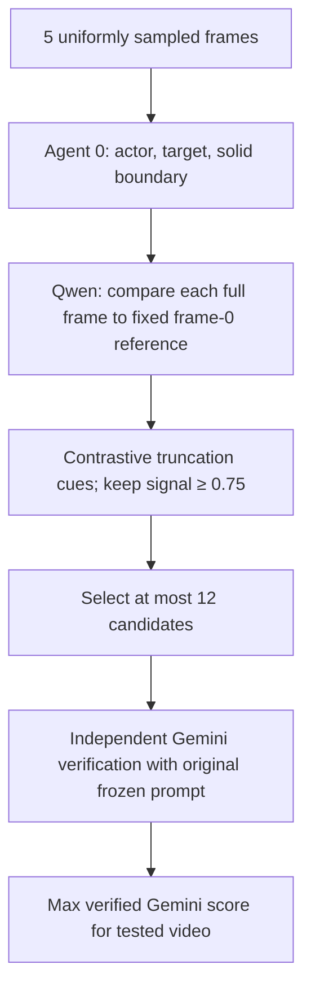
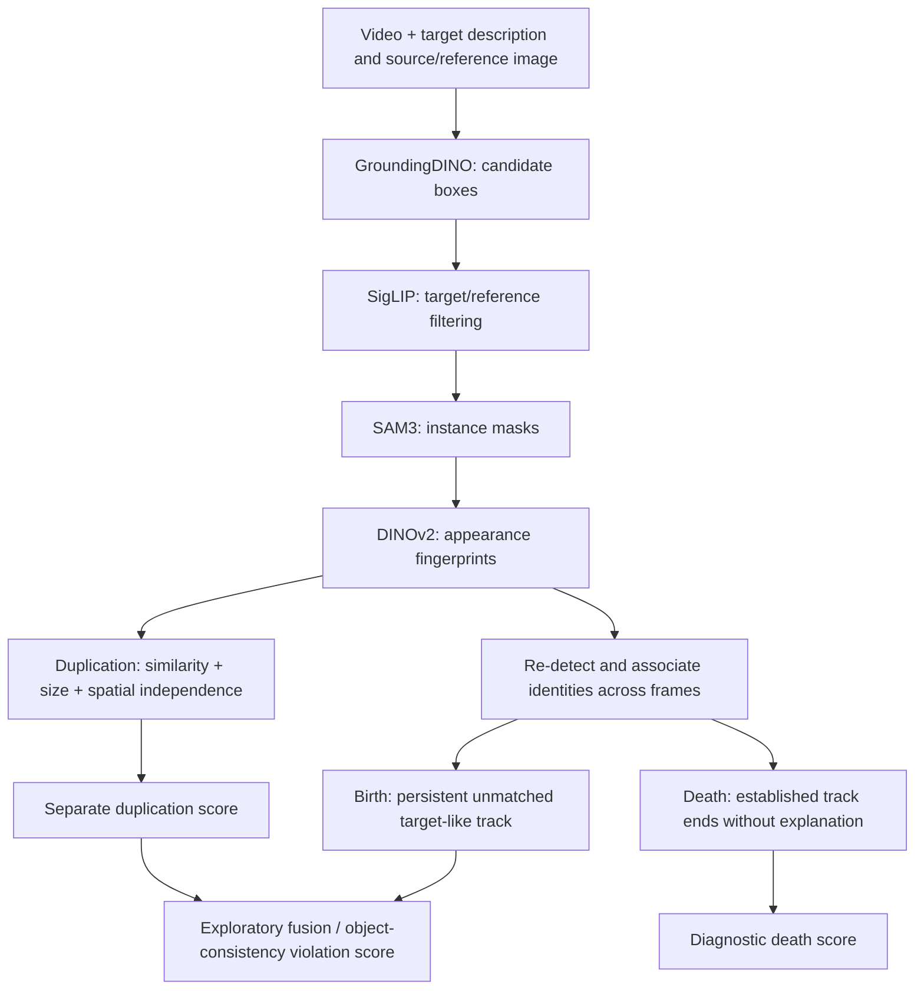
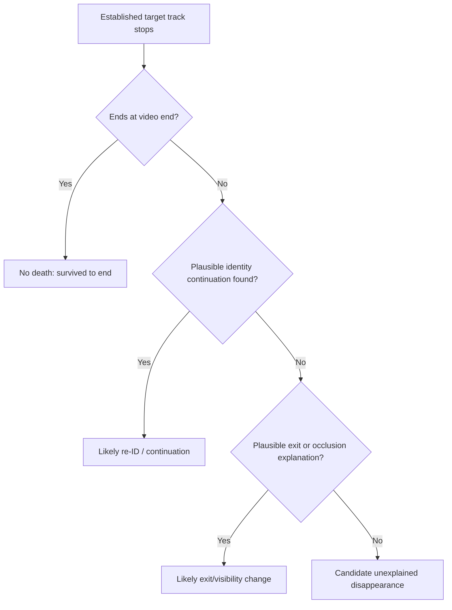

# Physical Plausibility Atlas

**Automated, interpretable evaluation of physical plausibility in AI-generated robot-manipulation videos**

[**Explore the interactive website and 141 videos**](https://zhuoying-yang.github.io/physical-plausibility-atlas/) · [Contact implementation](https://github.com/Zhuoying-Yang/contact-causality-evaluation) · [Penetration implementation](https://github.com/Zhuoying-Yang/penetration-evaluation) · [Duplication / identity implementation](https://github.com/Zhuoying-Yang/duplication-identity-analysis)

> **What this project does, in one paragraph.** A generated robot video can look photorealistic and still violate physics: an object moves without plausible robot contact, passes through a solid drawer wall, or appears twice/disappears unexpectedly. We develop **three complementary video-level visual evaluation families**—**Contact**, **Penetration**, and **Consistency / Persistency**—that locate relevant events, combine geometric/temporal evidence with vision-language-model verification, and assign interpretable scores. This repository is the unified *research atlas and video gallery*: it documents the current methods, displays the evaluated clips and recorded scores, and openly identifies unresolved cases. It is **not** a claim of exact 3D physics reconstruction or a single validated universal physics score.

## Start here: three questions, three metrics

| Dimension | Question asked about the video | What a high *case-level* score means | Most established result |
|---|---|---|---|
| **Contact / contact-supported response** | When the target responds, is there visually plausible robot–object contact supporting that response? | **Stronger evidence of plausible contact support** (better) | **AUROC 0.816**, 46 scored clear-binary videos |
| **Penetration** | Does an actor apparently cross **solid material**, rather than use a real opening or undergo ordinary occlusion? | **Stronger evidence of penetration** (worse); A/C scores are method-specific | **Type A Forward AUROC 0.8167**, 13-video development set |
| **Consistency / persistency** | Does the set of objects remain stable, without unexplained duplication, birth, or disappearance? | **Stronger evidence of an anomaly** (worse) | **Duplication AUROC 0.8528**, 54-video strict evaluation |

**Do not compare or average these raw scores.** Contact uses a 0–100 contact-support scale; Consistency and Penetration score physical violations, on different scales and evaluation subsets. The reported AUROCs measure *how well a score ranks human-labeled cases*, not how physically plausible an individual video is. A higher **AUROC** is better for every detector, but a higher **video score** does **not** mean the same thing across detectors.

### The evaluation philosophy



These dimensions can disagree for a good reason. For example, **`Cosmos2.5_0006`** is a **penetration-positive** example (Type A final score **0.45**) but also a **Contact failure**: its Contact human label is **No Contact**, even though FuturePair36 incorrectly produces **89.459**. One video can violate more than one physical constraint; likewise, a detector can be wrong about one constraint and right about another.

---

## 1. Contact: is an object response supported by plausible contact?

### 1.1 Definition and scope

Imagine a robot approaching a cup. If the cup starts sliding **before** plausible contact, that is a contact/causal-support failure, even if the gripper touches it later. Conversely, a visible gripper–cup contact followed by cup motion is supporting evidence. We measure **visible contact-support plausibility**, **not** exact calibrated 3D contact, robot force, or proof of true causal mechanism.

The final frozen method is **Whole-video Contact Event V2 / FuturePair36**.



### 1.2 The stages, explained in operational terms

**Step 1 — Geometry proposes moments worth checking.**

- **Input:** image-space robot/end-effector and target-object masks across the video.
- **Question:** *At which moments do the robot and target become close enough that a contact might occur?*
- **Method:** compute projected mask proximity; take **6 candidates from temporal bins** and **6 globally closest candidates**, using **12-frame temporal non-maximum suppression** to avoid redundant neighbors.
- **Output:** approximately 12 sparse candidate times, not a contact verdict.
- **Why:** this avoids asking an expensive VLM to inspect every frame and avoids letting target motion define contact candidates. **Object-response motion is never used to propose contact.**

**Step 2 — A VLM assesses contact evidence, not just 2D overlap.**

- **Input:** a high-resolution local interaction region from frames **`t-2, t-1, t`**; model **Qwen3-VL-8B-Instruct**.
- **Question:** *Is the gripper clearly separated from the target, depth-ambiguous, or plausibly touching a surface?*
- **Output:** probabilities for **A = separated**, **B = depth/contact ambiguous**, **C = plausible contact**, and the soft candidate score:

\[
S_{\mathrm{contact}}(t) = 100 \left(P(C\mid t) + 0.5P(B\mid t)\right).
\]

A clear separation gets little credit; ambiguity gets half weight; visually supported contact gets full weight. This is a **ranking score**, not a thresholded claim that contact certainly happened. The VLM is not given the human response-onset annotation.

**Step 3 — Track meaningful target-object response independently.**

- **Input:** tracked points from a reliable target-object region and local reference/background points.
- **Method:** use **CoTracker** to follow the **same point identities** over time, rather than framewise mask-centroid jitter.
- **ABS:** target motion in image coordinates.
- **LOCAL:** target motion relative to nearby tracked background, helping reject camera movement.
- **HYBRID:** require **ABS ∩ LOCAL**, with **2-of-3 temporal persistence**.
- **Output:** time-indexed evidence that the object physically responded.
- **Why:** segmentation flicker, partial occlusion and camera pans can all mimic object motion.

**Step 4 — Pair contact and response without trusting one fragile onset frame.**

For each contact candidate at frame `t`, look for reliable object-response evidence in the **following 36 frames**. Only then is its contact score eligible:

\[
\operatorname{FuturePair36}(V)=
\max_{t\in\mathcal C:\;\exists r\in[t,t+36]\;\mathrm{Response}(r)}
S_{\mathrm{contact}}(t).
\]

Here `C` is the geometry-proposed candidate set and `Response(r)` is the HYBRID motion evidence. **No usable final score** must be displayed as *No score / abstain*, **not invented as zero**. This whole-video max-over-eligible-events approach was selected because exact automatic first-response-onset detection was unstable.

**Why not simply find the first response onset `r₀` and search backward?** A diagnostic comparison on an earlier Fresh20 setting gave about **0.923 AUROC with human-oracle onset**, versus about **0.600 with automatically estimated HYBRID onset** using the same contact verification version. The temporal anchor, not just contact recognition, was the bottleneck. This motivates FuturePair36; the oracle comparison is **not** the final 46-case performance.

### 1.3 Contact evaluation

| Evaluation | Cases | Human labels | AUROC | Interpretation |
|---|---:|---|---:|---|
| **Primary frozen FuturePair36** | **46 scored clear-binary videos** | 35 Contact / 11 No Contact | **0.815584 ≈ 0.816** | **Main result** |
| Sensitivity without `Cosmos2.5_0006` | 45 | 35 Contact / 10 No Contact | 0.897143 ≈ 0.897 | Failure-mode sensitivity only; **not** the primary number |

The **58 contact videos** in the full gallery span Primary9 (9), Old Fresh20 (20), Pilot5 (5), Cosmos2.5 special cases (4), and New Fresh Expansion20 (20). Some are unresolved, excluded, borderline, or lack usable final model scores and are **not** counted in the 46-video AUROC. In the 46 scored binary cases there are **385 positive–negative pairs**, with **314 correctly ranked** and **71 misranked**. Human-label corrections retained in the frozen evaluation include `Cosmos3_seed103_0037 → Contact` and `Cosmos3_seed101_0035 → No Contact`.

**Representative cases:**

| Case | Human interpretation | FuturePair36 | Why show it? |
|---|---|---:|---|
| `Cosmos3_seed102_0020` | Contact | 66.067 | Contact-supported example |
| `Cosmos2.5_0024` | No Contact | 1.768 | Low score for a negative case |
| **`Cosmos2.5_0006`** | **No Contact** | **89.459** | **Known temporal-causality false positive** |

**Main failure mode:** `object begins moving → a visually valid contact occurs shortly afterward → motion continues`. The later event can satisfy the forward 36-frame window even though the initial response was unsupported. `Cosmos2.5_0006` alone accounts for **35 of the 71** ranking errors. **FuturePair36 does not rigorously establish that contact preceded the *first* response.**

**Why not use depth as a strict contact test?** Pilots with Video Depth Anything, masks and local depth offsets showed unstable depth order near fingers, container rims and occlusion boundaries; a full 3D/CAD registration system would compound errors from masks, monocular depth, pose and camera calibration. We therefore make the narrower, testable **visual-contact plausibility** claim.

**Implementation / provenance:** [Contact code and older ablations](https://github.com/Zhuoying-Yang/contact-causality-evaluation); final pipeline path `vlm_contact_oracle9/whole_video_contact_event_v2/run_contact_event_v2.py`. The later pooled 46-case snapshot is `final_results/OVERALL_FUTUREPAIR36_WITH_FRESH_EXPANSION.csv` in the original research workspace. Older standalone website tables **predate** this expanded result; use **0.816** here.

---

## 2. Penetration: did an actor cross solid material?

### 2.1 What counts as penetration?

A robot may legitimately drop a cube **through the open top** of a bin, move a gripper **over the rim** of a drawer, or hide an object **behind** a panel. None necessarily implies penetration. We seek evidence that the same actor crosses or straddles **rigid solid material** without a physically plausible path.

We distinguish three *visual failure mechanisms*, which are not guaranteed to be mutually exclusive:

| Type | Intuition | Illustrative case | Current status |
|---|---|---|---|
| **A — Boundary crossing** | Actor goes from one side of a solid wall to the other; test whether a legal opening/rim path explains it | `Cosmos2.5_0006` | **Forward pipeline evaluated on 13 videos**; backward trajectory test is separate |
| **B — Sustained embedding** | Gripper/actor stays visibly embedded in a solid object, not just momentarily overlapping | `Cosmos3_seed101_0019` (gripper/banana) | **Unresolved; no validated final detector** |
| **C — Abnormal boundary truncation / straddling** | Object appears partially cut off by a solid panel or fused through its material | `LVP_0051` | **Small reference-based verification pilot** |

### 2.2 Type A Forward: first-frame pair selection → transitions → verification



**Stage A0 — Choose what might penetrate what.** Input is **frame 0 and the task instruction** (if available), **not** the entire clip and **not** a human-annotated penetration frame. Agent 0 can propose up to **three** `actor–target–solid_boundary` pairs, with types such as `OBJECT_ENVIRONMENT` or `ROBOT_OBJECT`. Downstream currently scans **at most two**, prioritizing object–environment pairs. It can abstain. This matters: a legitimate gripper–wall pair can be omitted even if the video plainly contains a failure.

**Stage A1 — Scan temporal changes.** For each selected pair, **Qwen3-VL-8B** examines **adjacent full frames** `(t−1,t)`—**not pre-cropped frames**—and describes the actor relative to the solid boundary (e.g. `OUTSIDE_SIDE`, `INSIDE_CAVITY`, `ABOVE_OPENING`, `STRADDLING_RIM`, `OCCLUDED`, `UNCLEAR`). It proposes suspect crossings and raw scores; an apparent state switch alone is **not** yet proof.

**Stage A2 — Temporal audit and candidate selection.** Penalize conflicting adjacent-frame interpretations; keep candidate transitions with **postprocessed score ≥ 0.65**, merge nearby events, rank across monitored pairs and forward **up to 12** transitions for confirmation. This specifically counters noisy frame-to-frame state hallucinations.

**Stage A3 — Automatic local evidence.** On the **after** frame, Qwen predicts one normalized box containing the **actor, target, and relevant solid boundary**. Expand by about **7% of image size per side**, then apply **the same box** to the before and after frames. If localization is unreliable, fall back to full frames. This is a VLM-selected ROI, **not** a SAM mask or hand-drawn box.

**Stage A4 — Independent verification.** Gemini receives exactly **four images**: **full before**, **full after**, **crop before**, **crop after** (full images capped at roughly 960 px longest side; crops enlarged to roughly 1000 px). It checks identity, the physical boundary, and whether a real opening, over-the-rim path, transparent wall or ordinary occlusion could explain the transition. Uncertain candidates should not be forced positive. The video-level score is the **maximum verified Gemini candidate score**; an end-to-end abstention/no candidate can yield **0**, but **not run** must remain **null / not tested**.

**Observed limitation:** `Cosmos2.5_0013` is human-labeled penetration positive, but Agent 0 failed to select the relevant gripper interaction; its actual end-to-end Type A score is **0**. This is a **pair-selection miss**, not evidence that the video is safe.

### 2.3 Type A Backward: a separate trajectory diagnostic

An apparently suspicious transition from **inside → outside** a drawer may be a legal path **up and over the rim**. In a *separate exploratory test*, a reviewer manually selected a short gripper trajectory; **Sol** examined **19 ordered images**, tracking the same gripper tip relative to the same drawer boundary and asking whether an unobstructed path existed. This does **not** yet reuse the complete Agent 0 Forward pipeline and is **not** a validated video-level detector.

Window-level diagnostic scores: `Cosmos3_seed103_0055 → 0.13` (more consistent with a legal over-rim path), `...0056 → 0.47` (ambiguous), `...0057 → 0.36` (transparent-panel ambiguity). **Do not mix these diagnostic scores into Type A Forward AUROC.**

### 2.4 Type B: what remains unsolved

Canonical example: `Cosmos3_seed101_0019`, where the gripper appears to embed in a banana around frame **126** and stays suspicious through later frames. Detecting this reliably requires distinguishing surface grasping, occlusion, projection overlap and true intrusion into solid material.

An early apparent high-confidence Qwen result was **invalidated** because an experimental prompt exposed the expected answer/frame. Clean Qwen runs did **not** reliably identify the event; SAM3 fingertip separation and attempted Qwen fingertip localization were also unstable. **We report no valid Type B score or AUROC.** It is an important open failure mode, not a completed module.

### 2.5 Type C: reference-based abnormal truncation



The purpose is different from adjacent-frame Type A: the object may **already be straddling or oddly truncated** without a clean crossing moment. Type C therefore compares each candidate **full frame** with a **fixed first-frame `f0` reference**, checking if the object is increasingly cut off by what should be a solid boundary. Agent 0 here sees **five uniformly spaced frames**, unlike the **first-frame-only** Type A Agent 0. Qwen supplies candidate cues; **Gemini independently judges them using the original scene-specific verification prompt**. Do not leak Qwen's candidate answer into the verifier.

`LVP_0050` has a **forced-pair diagnostic** where Agent 0 originally abstained. Its zero Qwen signals are **not** a complete Type C end-to-end negative and must not be used as such in the main pilot evaluation.

### 2.6 Penetration results: distinguish validated stages from exploratory pilots

| Evaluation | Human GT composition | AUROC | Appropriate claim |
|---|---|---:|---|
| Type A, **raw Qwen** | Same 13: 3 positive / 10 negative | 0.3833 | Early candidate signal |
| Type A, **temporally audited Qwen** | Same 13 | 0.6167 | Postprocessing effect |
| **Type A Forward, Gemini verified** | **13: 3 positive / 10 negative** | **0.8167** | **Primary Type A development result** |
| Type C original-prompt Gemini **clear-label pilot** | **6: 2 positive / 4 negative** | **1.000** | Small **development pilot**, not external validation |
| **A+C pooled exploratory snapshot** | **16 distinct videos: 5 positive / 11 negative** | **0.8909** | **Not** a fully run/calibrated combined detector |

In the six-case Type C pilot, positives `Cosmos3_seed101_0048` and `LVP_0051` each scored **0.95**; negatives `Cosmos2.5_0004`, `_0005`, `_0054`, `_0056` each scored **0.00**. `LVP_0049` is an additional negative with rejected candidates; `Cosmos3_seed101_0052` has disputed GT and is not part of the primary six-case calculation.

The exploratory A+C pooled result used **`A / 0.45`** and **`C / 0.95`**, taking the maximum of whichever component was actually tested for each video. Crucially, **the same complete A+C suite was not executed on every video**. Hence **0.8909 is not evidence that combining methods improved performance**, and the normalization was not independently calibrated. Adding forced-pair `LVP_0050` would yield a 17-video number, but we do **not** use it as a primary result.

**Why not just use depth and segmentation?** Experiments with SAM3 masks, Video Depth Anything and CoTracker point-depth comparisons exposed unreliable finger masks, mask identity switches under occlusion and unstable monocular depth ordering. A strong single transition signal (e.g., `Cosmos2.5_0006`, local depth residual approximately −0.099913) is a *pilot observation*, not validated 3D penetration recovery. No reliable standalone ICP/3D penetration metric is claimed here.

**Implementation / provenance:** [Penetration repository](https://github.com/Zhuoying-Yang/penetration-evaluation), frozen branch **`freeze/20261010-type-a-forward-backward-type-c`**. Key Type A files include `penetration_typeA_agent0_literal_batch.py`, `penetration_agent0_v3A_literal.py`, `penetration_abc_agents_v3.py` and `penetration_A_v3_crop_gemini_score.py`. Type C uses `penetration_agent0_v3C_multiframe.py` and `typeC_gemini_original_prompt.py`. **Exact experiment prompts/configuration must come from frozen runners and recorded `rendered_prompt.json`**, not from this explanatory README.

---

## 3. Consistency / persistency: are objects conserved over time?

### 3.1 From duplication to temporal identity

A physically plausible video should not simply invent a second cup, erase an established cup mid-scene, or turn one visible object into two independent persistent objects without explanation. **Multiple identical cups can be perfectly normal if they were already present at the start.** The task is therefore *not* “count objects and flag any frame containing two”; it is to ask whether **the set of object identities evolves plausibly**.

Our current work is a progression from a mature **duplication-specific metric** to experimental **target-conditioned birth/death tracking**. These stages are not interchangeable.



### 3.2 Duplication detector (most mature Consistency component)

| Stage | Input → output | Why it matters |
|---|---|---|
| **GroundingDINO** | Prompt such as `white cup` → object-like bounding boxes | Proposes candidates without assuming perfect per-frame segmentation |
| **Source-conditioned SigLIP** | Original/reference object image + proposals → target-like candidates | Rejects visually unrelated objects in the same scene |
| **SAM3** | Candidate boxes → object masks | Provides instance region and approximate geometry |
| **DINOv2** | Cropped/masked instances → appearance embeddings | Tests whether candidate instances look like the same target type |
| **Semantic + size support** | Candidate pair → plausibility of being two target-like full objects | Reduces false matches and unrealistic part-size comparisons |
| **Spatial independence** | Pair geometry → penalty for fragments/parts of the *same* object | Distinguishes a genuine second object from a broken segmentation |
| **Temporal/video aggregation** | Pair evidence across frames → `size_spatial_peak` | Produces **higher score = more duplication evidence** |

A **false positive confound** is when a single rigid object is segmented into two pieces and mistakenly appears duplicated. `Cosmos3_seed101_0039` was a useful hard negative: spatial-independence reasoning reduced a size-only signal of roughly **0.50** toward **0.20**. This is *suppression of a confound*, **not** a finished standalone fragmentation detector.

**Strict duplication evaluation:**

| Score | Videos | Duplication GT+ / GT− | AUROC | Average precision (AP) |
|---|---:|---:|---:|---:|
| **`size_spatial_peak` (primary)** | **54** | **24 / 30** | **0.8528** | **0.8801** |
| `strict_size_spatial_peak` (numerical variant) | Same 54 | 24 / 30 | **0.8625** | **0.8866** |

A harder Seed102/103 re-audited subset contained **29 videos (5 positive / 24 negative)**: primary-score AUROC ≈ **0.8083**, AP ≈ **0.7485**; strict variant AUROC ≈ **0.8167**, AP ≈ **0.7985**. The 54-case set is the main duplication evaluation.

### 3.3 Tracking persistent *target-like* identities

The duplication score originally relied mainly on frame/pair evidence; it **did not itself maintain one reliable identity from beginning to end**. To extend the metric, we added a **lightweight detect–associate tracker**:

1. **Re-detect** candidate objects approximately **every three frames** with the target-conditioned proposal/appearance pipeline.
2. Match detections against existing tracks using **DINOv2 appearance similarity** and **normalized center displacement** (diagnostic matching cost approximately `0.75 × appearance difference + 0.25 × center-motion difference`).
3. A matched detection **continues** its track (`T00`). A sufficiently distinct unmatched detection **starts** another (`T01`).
4. Test whether a new track is **persistent, spatially independent and coexistent** with an older one, rather than merely caused by a one-frame detector dropout.

Those association weights and gates were empirical diagnostic settings, **not universal learned thresholds**. **The formal birth/death results do not use CoTracker.** CoTracker + depth + point-cloud ICP was a prospective direction, not the reported production consistency pipeline.

### 3.4 Birth: unexplained new target-like instance

A new track is a *hypothesis*, not automatically a physical error; it might be false detection, reidentification or fragmentation. Birth scoring therefore considers **reference similarity, detection confidence, novelty, persistence duration, coexistence with the original track and spatial separation**.

**Readable example — `Cosmos2.5_0016`:** track `T00` exists from frame 0. A new, separate `T01` starts at **frame 27**, remains through **frame 92**, and coexists with `T00` for about **65 frames**. Its reported birth score is approximately **0.7953**, classified in the diagnostic as **strong unexplained birth**. The crucial proof-of-concept is not just “there are two boxes” but **“the original identity remains while a second independent, similar identity appears and persists.”** Another strong birth case is `Cosmos3_seed101_0020`, candidate `T10` at frame 120 through 188, birth score about **0.9116**.

**Birth audit:** **20 manually reviewed videos**, AUROC approximately **0.780**, AP approximately **0.727** (score file `consistency_v1/BIRTH_SCORE_V5_AUDIT20.csv`). This is an *experimental broader phenomenon* than duplication and should not be presented as outperforming duplication on the same target.

**Important blind spot:** because candidate discovery is **target-conditioned**, a video prompted for `cup` can hallucinate an entirely unrelated **fork** that the detector never proposes. The relevant human-visible example is **`Cosmos3_seed102_0062`**, **not** `Cosmos3_seed101_0065`. We have **not established automatic successful detection of that unrelated fork**. Future general object-set conservation requires open-vocabulary scene-level discovery.

### 3.5 Death: did an established object disappear without explanation?

A tracking ID terminating is *not* equivalent to object death. The diagnostic death branch distinguishes:



An illustrative disappearance video is **`LVP_0004`**, with a human-observed target disappearance near frame **36**. The death audit used **20 videos, only 1 human-positive and 19 negatives**; AUROC **0.8947**, AP **0.3333**. With **only one positive**, this is **diagnostic and statistically fragile**, **not** a headline generalization result.

### 3.6 Broader consistency fusion: a different benchmark

One exploratory combination uses the primary duplication score and the birth evidence:

\[
S_{\mathrm{consistency\ violation}}(V)
=\max\left(\operatorname{size\_spatial\_peak}(V),\;0.25\,\operatorname{birth\_score\_v5}(V)\right).
\]

On a **broader-label 54-video set (27 positive / 27 negative)**, a reported fusion evaluation gave **AUROC ≈ 0.818**, **AP ≈ 0.866**. **Do not compare 0.818 vs 0.8528 as if they are the same dataset and GT**: the broader consistency task includes more error types and a different positive/negative composition. The experimental source tables include `consistency_v1/FINAL_CONSISTENCY_SCORE_55.csv` and `FINAL_CONSISTENCY_EVAL_V2/FINAL_OBJECT_CONSISTENCY_SCORES_V2.csv`; the latter should be inspected before a definitive new unified benchmark claim.

**What is not solved:** arbitrary new semantic objects; robust identity through heavy occlusion; maintaining several initially identical instances; independent splitting/fragmentation detection; general rigid-shape deformation; fully reconstructed 3D identity/surface persistence. Deformation has been explored separately and should **not** be counted as solved by this implementation.

**Implementation / provenance:** [Duplication/identity code](https://github.com/Zhuoying-Yang/duplication-identity-analysis) and [older illustrated duplication site](https://zhuoying-yang.github.io/duplication-identity-evaluation/). Primary duplication scoring uses `identity_v1/final_size_spatial_ablation.py`, `FINAL_SIZE_SPATIAL_VIDEO_SCORES.csv`, and `FINAL_SIZE_SPATIAL_PAIR_SCORES.csv`. Expanded birth/death analysis is under the research workspace's `consistency_v1/` folder and is **not** necessarily all present in this public atlas repo.

---

## 4. How to read the quantitative results correctly

The headline numbers describe **different tasks and evaluation populations**. They are not three estimates of the same underlying statistic.

| Method | Positive label means | Evaluation size | AUROC | Main caution |
|---|---|---:|---:|---|
| **Contact FuturePair36** | Contact-supported interaction | **46 scored binary** | **0.816** | Can accept contact occurring *after* initial unsupported motion |
| **Penetration A Forward** | Solid-boundary crossing | **13** | **0.8167** | Small development set; pair selection can miss a gripper |
| Penetration C | Abnormal solid-boundary truncation | **6** | **1.000** | Development pilot only; just two positives |
| **Consistency duplication** | Duplication | **54** | **0.8528** | Primarily target-like duplication, not complete conservation |
| Consistency birth | Unexplained target-like birth | **20** | **≈0.780** | Experimental target-conditioned tracker |
| Consistency death | Unexplained disappearance | **20** | **0.8947** | **One positive only**; do not headline |
| Broader Consistency fusion | Broader object-consistency violation | **54** | **≈0.818** | Different labels / population from duplication benchmark |

**No independently validated overall Contact+Penetration+Consistency score is presented.** A future joint metric needs *the same video manifest*, independent human GT for each failure dimension, valid outputs of all component methods on every required clip, separate calibration and untouched held-out testing. The exploratory Penetration A+C max pooling is **not** that joint metric.

### Case status and ground-truth rules

- **Measured `0`** = the frozen method actually ran and returned zero (including, where applicable, a recorded pipeline abstention). It does **not** necessarily imply an error-free video.
- **`No score` / `ABSTAIN`** = no usable final output was produced; **not** interchangeable with zero. For Contact, never replace missing FuturePair36 with a different ablation's `max_event_score`.
- **`Not tested`** = this metric/branch was not executed for the clip. Missing branches are **null**, not fabricated negatives.
- **`Unresolved`, `0.5 Borderline`, `Exclude`, `GT disputed`** = human annotation is not a clear binary label; do not insert into binary AUROC without an explicit, defensible protocol.
- **`Diagnostic only` / `Forced pair`** = intermediate, manually selected or non-end-to-end experiment; keep separate from primary pipeline results.
- **Positive and negative labels are *metric-specific*.** A clip can be Contact-negative and Penetration-positive without contradiction.

---

## 5. Dataset, gallery, and representative investigations

This release indexes **141 distinct video IDs** drawn from **Cosmos2.5**, **Cosmos3 seeds 101/102/103**, and **LVP**. The research records include **58 Contact entries**, **68 Consistency entries** (including control/audit-only records), and **37 Penetration entries**: **163 metric-specific entries**, with overlaps across dimensions, not 163 unique MP4 files. The gallery includes unsolved and no-score entries deliberately; a gallery count is **not** an AUROC sample size.

Browse the [interactive Video Library](https://zhuoying-yang.github.io/physical-plausibility-atlas/), search by ID, filter by task/metric, and view the original clip's compressed playable copy next to the available human annotations and scores.

| Video ID | Read it for... | Main scientific point |
|---|---|---|
| [`Cosmos2.5_0006`](https://zhuoying-yang.github.io/physical-plausibility-atlas/) | Contact and Penetration | Contact false positive (`89.459`, GT No Contact); A Forward detects penetration (`0.45`, GT positive) |
| `Cosmos2.5_0013` | Penetration A miss | Agent 0 failed to monitor a crucial gripper pair; positive GT, end-to-end score `0` |
| `LVP_0051` | Penetration C | Clear abnormal boundary truncation; Gemini pilot score `0.95` |
| `Cosmos3_seed101_0019` | Unresolved Type B | Persistent gripper–banana embedding not reliably detected by clean model runs |
| `Cosmos2.5_0016` | Consistency birth | `T00` and newly appearing `T01` coexist for ~65 frames |
| `Cosmos3_seed101_0039` | Consistency hard negative | Fragmentation-like detection error suppressed by spatial independence |
| `LVP_0004` | Consistency death | Apparent disappearance; death evaluation remains a one-positive diagnostic |
| `Cosmos3_seed102_0062` | Unrelated object hallucination | Human-visible fork-like appearance that target-conditioned birth may miss |

### Repository structure and video publication

```text
physical-plausibility-atlas/
├── README.md                # This self-contained methods/results guide
├── index.html               # Interactive visual atlas + score gallery
├── videos/
│   ├── manifest.json        # Per-case ID → relative MP4 URL
│   ├── Cosmos2.5_0006.mp4
│   └── ...                  # 141 H.264 MP4 clips
├── scripts/
│   ├── case_ids.json        # Publication case-ID list
│   └── publish_videos.py    # Mac-side video mapping/encoding script
└── .nojekyll
```

The committed MP4s are **compressed, silent H.264 viewing copies** so GitHub Pages can stream them. They are **not model intermediate outputs or lossless scientific source files**; original videos were not modified by publication. The published site is static: it reads the committed `videos/manifest.json` and **does not require private absolute Mac paths or a local Python server**. The video gallery and result tables are curated **snapshots** of prior experiments; publishing the site **does not rerun inference**.

### Reproduction and source-of-truth boundaries

This repository is intentionally optimized for **communication, inspection and comparison**, not as one monolithic runnable pipeline. The model-specific implementations, prompts, checkpoints and detailed experiment tables live in the individual projects:

- [Contact Causality Evaluation](https://github.com/Zhuoying-Yang/contact-causality-evaluation) — geometry proposals, Qwen verification, CoTracker response processing, FuturePair36 and ablations. The **46-case** merged evaluation is newer than some public standalone results.
- [Penetration Evaluation](https://github.com/Zhuoying-Yang/penetration-evaluation) — frozen Type A scripts, experimental trajectories and Type C prompts; reproduce only with the **frozen prompt version** and appropriate model/runtime.
- [Duplication Identity Analysis](https://github.com/Zhuoying-Yang/duplication-identity-analysis) — duplication-specific code and main output tables; broader `consistency_v1` audit files may be in the original research workspace.

Exact production inference may require separately obtained model weights, a configured HPC runtime, video/GT manifests and authorized cloud-VLM credentials. **Do not infer reproducibility from the static HTML alone.** Human labels, selection criteria, prompt versions, status fields and final-score provenance should be retained if re-running or extending the benchmark.

---

## 6. Scientific takeaways and next steps

**What we can currently support:**

1. **Contact:** a two-branch contact-and-motion signal with future pairing provides a meaningful video-level contact-support ranking across 46 clear-binary scored clips (**AUROC 0.816**), while exposing a specific short-gap temporal-causality failure.
2. **Penetration:** pair-selected frame-transition scanning plus independent full/crop verification improves over raw Qwen signals on a **small Type A development set** (**AUROC 0.8167**); Type C demonstrates an interpretable reference-based pilot; Type B and a robust unified A/B/C detector remain open.
3. **Consistency:** appearance- and geometry-aware duplication scoring is the most established branch (**54-video AUROC 0.8528**); lightweight temporal association expands the error taxonomy to target-like births and diagnostic deaths but does not yet solve general scene-object conservation.

**Priorities:** evaluate penetration branches on a shared, prospectively defined GT set; improve Agent 0 gripper/boundary selection and legal-path reasoning; add open-vocabulary object discovery and robust track re-identification; collect more independent penetration/death positives and hard negatives; quantify correlation with actual downstream robot execution only when execution outcome data are available.

**Interpretive boundary:** the work measures **observable visual physical-plausibility evidence in generated videos**. It does **not** establish exact collision geometry, physical force, full 3D conservation, or a proven relationship to robot execution success.

---

**Last research-result snapshot:** 12 October 2026. The website is an evolving research communication artifact; for new quantitative claims, use frozen experiment outputs, explicit sample counts and their corresponding GT manifests.
